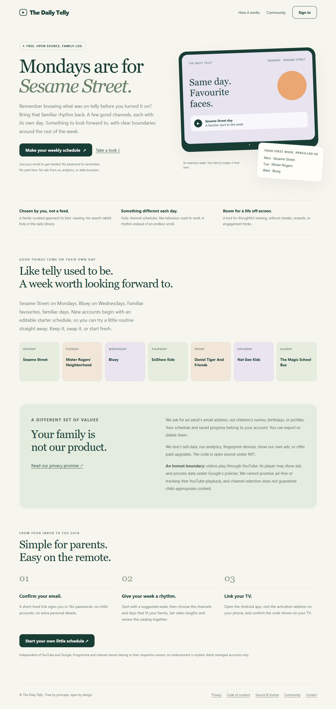

# The Daily Telly

**Good things come on their own day.**

Remember knowing what was on telly before you turned it on? The Daily Telly is a
free, open-source platform for a familiar weekly rhythm of family viewing.
Adults choose YouTube channels by weekday, set viewing rules, and link their TV
to a private household account. No endless discovery feed.

[Try The Daily Telly](https://thedailytelly.com) ·
[Community](https://thedailytelly.com/community) · [MIT license](LICENSE)



## A little shape to the week

| Day | Example channel |
| --- | --- |
| Monday | Sesame Street |
| Tuesday | Mister Rogers’ Neighborhood |
| Wednesday | Bluey |
| Thursday | SciShow Kids |
| Friday | Daniel Tiger And Friends |
| Saturday | Nat Geo Kids |
| Sunday | The Magic School Bus |

Programme and channel names belong to their respective owners. This independent
project is not endorsed by them or by YouTube. Channel selection is a starting
point for adult review, not a guarantee of child-appropriate content.

## Features

- Email-only registration and confirmed, single-use, browser-bound sign-in links.
- An editable starter schedule, with a friendly introduction on first sign-in.
- Owner-managed starter defaults, copied from the owner's selected public catalog.
- Separate household libraries, filtering, saved progress, export and deletion.
- Android/TV activation with expiring codes and revocable viewing-only credentials.
- One optional welcome check-in at the first 8 p.m. Eastern at least 24 hours after
  confirmation, summarizing selected channels and available video metadata.
- Branded HTML emails with plain-text alternatives and no added tracking pixels.
- An owner panel for starter defaults, account auditing, and server utilization.
- Sustained-load Pushover alerts, SMTP/Resend support, and signed inbound forwarding.

## Privacy by principle

No ads from us, paid tiers, analytics, fingerprinting, or sale of personal data.
Accounts need an adult email, not children's names, birthdays, or profiles.
Household schedules and progress remain private to their account. Starter data
contains public channel/video metadata, never another household's watch history.
The optional welcome email is one check-in, not a recurring newsletter.

**YouTube remains a third party.** Its thumbnails/player can process data and
show advertising. This app cannot promise ad-free or tracking-free YouTube playback,
classify every video, or act as a device kiosk. See [privacy](docs/privacy.md),
[conduct](CODE_OF_CONDUCT.md), and [platform considerations](docs/platform-considerations.md).

## Run locally

Python 3.11+, one worker, no frontend bundler:

```powershell
python -m venv .venv
.venv\Scripts\Activate.ps1
pip install -r server/requirements-dev.txt
$env:DAILYTELLY_ENV = 'development'
$env:DAILYTELLY_PUBLIC_URL = 'http://127.0.0.1:18400'
$env:DAILYTELLY_MAIL_MODE = 'file'
$env:DAILYTELLY_OWNER_EMAILS = 'you@example.com'
python -m uvicorn app.main:app --app-dir server --host 127.0.0.1 --port 18400 --no-access-log
```

Linux/macOS: activate `.venv/bin/activate` and use `export` for environment values.
The process environment is authoritative; `.env` is not loaded automatically.
Open the localhost URL. Development sign-in messages are written to
`server/data/dev-mail`, never sent. Open the link in the same browser that requested
it, then confirm. Use only synthetic addresses during development.

Set `YOUTUBE_API_KEY` for real channel resolution/sync. The source repository does
not contain a runtime database or someone else's library. To prepare starter
defaults, add channels to your owner account, open `/owner`, choose weekdays, and
publish the starter schedule. This snapshots public metadata for future accounts.

## Tests

```bash
python server/tests/logic_test.py
python -m pytest
```

Tests use synthetic accounts and mock external services. Coverage includes account
isolation, pairing, migration, starter seeding, Eastern daylight-saving transitions,
reminder preferences/idempotency, and signed inbound forwarding.

## Android and TV

The app uses package `com.dailytelly.app` and defaults to
`https://thedailytelly.com`. First launch shows an activation URL and code; an adult
signs in in their browser and approves the code displayed on their own TV.

```powershell
cd android
.\gradlew.bat assembleDebug assembleRelease lintRelease
# Emulator development:
.\gradlew.bat assembleDebug -PplatformUrl=http://10.0.2.2:18400
```

JDK 17+, SDK 35, and Build Tools 36.0.0 are required. The checksummed Gradle wrapper
is included. Keep release signing keys outside the repository. Existing apps with
a different package identity need a fresh installation and pairing.

## Operate your own instance

Read [setup](docs/setup.md), [architecture](docs/architecture.md),
[deployment](docs/deployment.md), and [release checks](docs/releasing.md).
Use HTTPS, a private persistent data directory, a verified sender, one worker,
reasonable quotas, and operator-enforced backup/deletion retention.

The owner allowlist is configured with `DAILYTELLY_OWNER_EMAILS`. Sign in as an
allowlisted verified adult email and visit `/owner`. Starter defaults affect future
accounts, not existing schedules. Welcome check-ins run at 8 p.m. America/New_York,
using Resend idempotency and optional email preferences. An existing SQLite backup
can be imported into a verified empty account with `scripts/import-library.py`;
inspect its dry run before applying. See [migration](docs/migration.md).

This is a single-node SQLite application. Review capacity, YouTube/platform policy
requirements, child-directed service obligations, and real-device behavior for
your deployment before inviting users at scale.

## Community

[Discussions](https://github.com/alex-the-fifth/thedailytelly/discussions) for questions
and ideas; [issues](https://github.com/alex-the-fifth/thedailytelly/issues) for bugs
and feature proposals. Read [contributing](CONTRIBUTING.md), our
[code of conduct](CODE_OF_CONDUCT.md), and [security reporting](SECURITY.md).
Never post private family data or credentials in public threads.

MIT licensed. Third-party content and dependencies retain their own rights.
